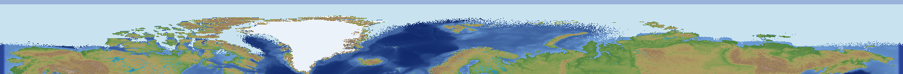

# Cylinder World — Vintage Story 1.22

**14 November - 1.1.0 (companion of Earth 2.0.0):** the whole mod was reviewed (area audits, Codex correctness and
design reviews, a final code review) and fixed, and gains a per-world seam mist switch. Generated terrain stays the same
as 1.0.4 except the fixes listed here and, in new plain Cylinder World worlds, the landform layout (CW-D50). Worlds made
before keep their saved behaviour. Requires Vintage Story 1.22.0 or later; Earth is optional. Details and reasons:
[decisions](docs/DECISIONS.md) CW-D38 to CW-D52.
- **Game updates:** every Harmony patch and every reflected game member goes through one place (CW-D39). If a game update
  renames one, adds an overload or breaks a transpiler, only that feature switches off, with one log line naming what
  is missing (`Cylinder World: … is off: …`).
- **Seam mist per world** (CW-D48): the world option **Seam mist** (`cylinderSeamMist`, Earth tab, unticked by default,
  changeable later) switches the seam mist and jump fog; worlds without it follow the config's `SeamMist`.
- **Rain with Earth's weather** (CW-D38): the seam's rain fold steps aside while another mod drives vanilla's weather
  (Earth's `seacontracts:weather` role), and only when that mod's rain patch is really on. It no longer blocks other
  mods' rain patches, and failing weather pairs back off.
- **Block edits across the seam** (CW-D40): chests and other containers changed through their inventory now reach the
  other copy and the saved journal (before, the other copy kept the old items and a reload restored them); seasonal sea
  ice is no longer journaled (it grew without bound near the seam in Earth worlds); edits from other threads are applied
  on the main thread; a journaled block from a removed mod is skipped instead of crashing the server; the journal keeps
  only what an unloaded copy still lacks. It catches every change before a column unloads or the world saves, never
  drops a hopper's items twice, keeps a container's late slot changes, and a broken block entity costs only its own cell.
- **Crossing:** a blocked crossing no longer resets the prepared other side; players (and what they ride) past the line
  wait until the destination is loaded and only then cross, with the usual landing check; other players and shared boats
  stay smooth through a jump; cube blocks (the ice walls, sea ice, gravel) keep their texture variant at the jump; a
  teleport the server announces as a wrap is a seam jump on the client (a `/tp` of about one ring lands where the server
  says), and any other one-ring teleport still gets the client's jump handling.
- **New worlds:** a world whose first start stopped before generating anything (Earth's data download failing) is set
  up as new on the retry (CW-D41), and an `earth-creating` key left in a played world doesn't make it new; Earth's lakes,
  salt lakes and rivers in the band keep their water (CW-D42); Earth worlds fit the story chain to Earth's real polar
  limit; small worlds keep an identical band part before the jump line. A world whose block ids can't be set up, or a
  band-lakes world with an Earth that lacks their water level, is refused instead of generated wrongly. A new world
  with this mod's latitude gets the planet's pole distance as `polarEquatorDistance` (CW-D50), so other mods that read
  it agree with the latitude; in plain worlds this also moves vanilla's landforms.
- **Worldgen fixes (new chunks):** no lava or water sources in the mod's ice anywhere in the polar zone (CW-D43); the band
  is identical below its floor where a lower neighbour shows it; the mantle curtain also runs under the polar band, and
  in Earth worlds under the jump line where Earth's rock floor reaches it. Rivulet sources already saved in older worlds'
  polar walls are taken out once per column on load (CW-D49).
- **Earth worlds:** hot springs are left to Earth, which places them only at real geothermal sites (Deception Island,
  Mount Erebus); Cylinder World keeps them out of the lifeless kilometre at the Walls only (CW-D46).
- **Climate:** the live temperature correction is applied once per reading (vanilla's catch-up loops reused one reading
  and drifted it by tens of degrees); the weather sync is cheaper and takes vanilla's lock; in Earth worlds the cold
  exposure counts the polar sea only where it is frozen under the player. `ExtendTemperatureRange` is saved with each
  new world (it also changes world generation's climate readings) and is off in Earth worlds, where Earth's own setting
  extends the real climate (CW-D47).
- **Config and commands:** a config file that fails to load is left as it is (it used to be overwritten with defaults);
  `PolarIceMode` values are `default` (automatic), `earth`, `plateaus`, anything else warns and means `default`; the dead
  `BarrenDepth` key is gone; `/cyl map` works from the server console; `/cyl goseam` lands on the surface. A save made by a
  newer layout is refused instead of generated with this one. A Release build keeps other versions' zips.
- Also carries the earlier four-round review's fixes, which the 1.0.x line didn't have (they were play-tested in
  0.11.15-playtest.1 to .9): exposure kept over relogs, per-side temperature clamps, sea ice near players first, overworld
  only, guarded Earth patches and more ([review follow-ups](docs/review-followups.md)).
- **Code review of 14 November** ([review](docs/code-review-2026-11-14.md)): an edit of the last moment before the server
  stops reaches the other seam copy too (the shutdown save missed it); vanilla's snow is left to each seam copy, as the
  seasonal sea ice is, instead of being copied cell by cell (CW-D51: in a winter at the seam the journal held 100,000 or
  more cells and a save took up to 124 ms; the two sides can be a snow layer apart at the jump, and a crossing on foot lands in it); each
  save logs the journal's size and `/cyl info` shows it in the band; `FlattenSeabed` is saved with each new world
  (CW-D52); a damaged seam record refuses the world with a sentence instead of a bare error; a server with the mod
  switched off puts none of its patches on the game; cold exposure ignores other dimensions.

**1 November seam crossing - 1.0.4:** the crossing fixes from the 0.11.15 play-test line (author-tested in playtest.9): no black frame at a jump (CW-D32); the jump keeps the player's motion and the plants' look (CW-D33); creatures and other players stay visible across the jump line (CW-D34); the whole local motion history moves with a jump (CW-D35); block changes in the seam band update both copies, and unloaded counterparts replay a saved journal (CW-D36). The play-test review-round fixes are not included. **The polar layout is now automatic** (CW-D37): `PolarIceMode` "default" gives a new Earth world Earth's polar layout (Antarctica, seasonal sea ice, land across the seam) and any other new world the ice plateaus, so players set nothing; "earth" behaves the same but warns outside Earth, and the new "plateaus" forces the plateaus. Saved worlds keep their layout.

**1 November seam land - 1.0.3:** in Earth worlds with `PolarIceMode` "earth", Earth's land on the jump line (St. Lawrence Island, the Diomedes) now continues across the seam instead of being cut by a sea channel (CW-D31, ported from the play-test line). New worlds only; other worlds and modes are unchanged. Includes the 1.0.2 polar-wall lava fix.

**1 November polar-wall fix - 1.0.2:** prevents vanilla lava/water rivulets from generating in polar wall columns. Native server regression: both walls 0 lava sources (previously 72/83), ordinary-terrain control unchanged at 64. Applies to new chunk generation; existing saved lava needs separate cleanup. Play-test .9 installed 2026-11-01 10:12:02 Europe/Riga at the author's request; .8 backed up, settings and saves unchanged. Public 1.0.2 remains a publishing candidate. [Details and verification](docs/wall-lava-fix.md).

**31 October Earth+ update — 1.0.1:** Cworld declares the shared Earth+ creative tab directly in its three ice block definitions and English language assets. This package retains the prior DLL/runtime; only four JSON assets and the manifest version change. Older release ZIPs are preserved. See the Earth+ entry in [decisions](docs/DECISIONS.md).

**1.0.0 - first public release.** Primarily tailored for Earth Map; ongoing work focuses on testing, refinements and broader mod compatibility.

The world wraps east–west. Both world edges are covered by a misty ocean band; anything that
crosses the jump line in the middle of that sea is teleported to the matching spot on the other side.
Because both sides of the jump are identical open sea, down to the seabed, the jump itself isn't visible.

```
x: 0 ── t ────── H ════════ land ════════ W-H ────── W-t ── W
   [   ocean band   ]                     [   ocean band   ]
        ▲ jump line                              ▲ jump line
   x < t  → x += C         x > W-t → x -= C         C = W - 2t (circumference)
```

The north and south (Z) edges end in **THE Wall** behind an **Antarctic ice sheet** (layout v9 and later):

```
 THE WALL ▌▀▀▀▀▀▀▀▀▀▀▀▀▀▀▀▀▀▀▀▀▀▀▀▀▀▀▀▀▀▀▀▀▀▀▀▀▀▀▀▄▄__ tundra (land)       /  ice cliff or ramp ~ floes ~ polar sea
          ▌ ice sheet: flat plateau ~70 above sea, lifeless   steep edge     (polar bears, foxes; muskox further out)
          ▌ grounded on land and on a raised seabed; floats only near its edge over the sea
```

- **The Wall**: unbreakable, noise-shaped face, four ice shades in strata. It rises about 48 blocks above the plateau.
  Mining, explosions and building within 32 blocks are blocked (creative mode is exempt). Survival players who get
  on top of it or behind it are put back in front.
- **Ice sheet** from 85° latitude to the Wall (about 2.8 km in a 102.4k-long world). It uses the Antarctic (Vialov)
  profile: a nearly flat plateau about 70 blocks above sea level, dropping steeply only near its edge. The edge is
  fractal, with lobes, tongues and icebergs. In places it's a 15–25 block ice cliff, elsewhere a low ramp down to the
  water. Nothing natural sticks out of it: terrain higher than the ice is planed off and buried, and every hill
  on the sheet gets an ice mantle, so deep on the sheet buried mountains end flush with the smooth ice. Near the edge,
  mountains become ice-capped slopes down into the sheet, and within 320 blocks beyond it their tops are planed
  and ice-capped along a 1-in-4 ramp (no cut faces). Vanilla snow covers it. Nothing spawns on it: the only top
  surface is the mod's ice. 85° keeps it clear of all
  land on an Earth map: the northernmost land is about 83.6°N.
- **Sea side**: a continental shelf raises the seabed under the sheet, so the ice is grounded and floats only near its
  edge. Beyond the edge, **sea ice floes** thin out over 256 blocks. Polar bears and arctic foxes (cold-climate meat
  eaters) may spawn on floes, which are always beyond the ice sheet.
- **Tundra** from 76° to the ice sheet is vanilla arctic: polar bears, foxes, muskoxen further out. Trees fade out
  across it, and low shrubs thin out.
- **Temperature**: vanilla's climate map can't store anything below −20 °C, but live temperatures (after seasons)
  aren't capped. The mod corrects the base of every temperature query to its true value: the climate curve, altitude
  and ice-sheet cold. The plateau at the Wall averages −40 °C, which vanilla's seasons turn into about −8 °C in summer
  and −73 °C in winter.
- **Winter rule** on the ice sheet: below −40 °C a cold exposure meter fills. It's faster the colder it is (full rate at
  −65 °C) and the nearer the Wall. It fills in 4 minutes at the Wall in deep winter, and a nearby fire only halves the
  rate. When full, frost damage kills. Vanilla's frost screen effects follow the meter, and chat messages warn as it
  rises. In winter, on foot, you freeze to death before reaching the Wall (walking: ~2 km in; sprinting: just short).
  A fast mount can make it. Summer on the ice is plain vanilla: survivable for days with good gear. `/cyl info` shows
  the live temperature and your exposure.

The mod's wall and glacier blocks use the Stone material: the world map treats every Ice block other than vanilla's
`glacierice` as lake ice (flat, no relief, dark water-edge outlines at every step). They still show glacier white.

Renders from the offline test: `docs/ice-sheet-planing.png` (plan view: planed and buried mountains), `docs/ice-sheet-edge.png` (plan view of the sheet edge and floes), `docs/ice-sheet-side.png` (profile).

The textures in `assets/cylinderworld/textures/block/wallice/` are tinted copies of vanilla's packed glacier ice,
made by `tools/make-ice-textures.ps1`.

**The map is the planet.** The equator is the map center and the poles are the two wall faces.
Vanilla's repeating pole/equator bands and its polar-equator distance setting are replaced:

```
z: 0 ─ N wall ─ arctic ─ cold ─ SPAWN (starting climate) ─ warm ─ EQUATOR (map center) ─ warm ─ cold ─ arctic ─ S wall ─ L
```

- **Temperature** is `PoleTemperature` (−30 °C) at the walls and `EquatorTemperature` (30 °C) at the equator, following
  cos(latitude)^1.25, which matches Earth's yearly averages. From equator to pole, 0 / 15 / 30 / 45 / 60 / 75 / 90°
  gives 30 / 27 / 20 / 9 / −5 / −19 / −30 °C.
- **Latitude** runs from +90° at the north wall to −90° at the south wall and drives vanilla's sun and seasons.
  Days lengthen and shorten with the seasons, there's polar day and night near the walls, and the southern hemisphere
  has reversed seasons.
- **Spawn is moved** (new worlds only) to the latitude where the curve gives your world's starting-climate temperature.
  A temperate start (10 °C) lands at about 44°N. It stays on the map's middle X, and land is forced there.
- **Story locations move with spawn.** Vanilla anchors the story chain on the map center, so the mod shifts every
  location by the same offset right after vanilla picks them, before anything is generated. If the chain wouldn't fit
  between the walls (at 100% it reaches 19.2k blocks E/W and 12.8k N/S of spawn), the mod lowers the world's
  "story structures distance scaling".
- **A terrain generator can choose spawn instead** (0.11.11): `CylinderWorldCore.SetSpawn(x, z)`, called in a new world
  at `WorldReady` (after Cylinder World's own handler, before world generation), makes that the spawn. The story chain
  then moves there and the story scaling is fitted to it. Earth Map calls it with its real-geography spawn.

| World (W × L) | Ring (circumference) | Spawn → equator | Spawn → north wall | Tundra band | Story scaling | Seam from spawn |
|---|---|---|---|---|---|---|
| 51.2k × 25.6k | 50.2k | 6.2k | 6.6k | 2.3k | 43% | 25k |
| 102.4k × 51.2k | 101.4k | 12.4k | 13.1k | 4.5k | 94% | 51k |
| **256k × 102.4k** (Earth proportions) | **204.8k** | 24.8k | 26.3k | 9k | 100% | 102k |

**Earth proportions** (`EarthProportions`, on by default): when the map is at least twice as wide as it is long,
the jump lines move inward so the ring is exactly 2 × the length, like Earth (pole to pole = half the circumference).
With the 256k × 102.4k presets, the jump lines sit 25.6k in from each edge and the ring is 204.8k. The strips beyond
the jump lines are seam ocean nobody ever reaches or sees, so they're never generated and cost nothing.
`/cyl map` renders just the ring (see `docs/preview-earth.png`).

Worlds made with 0.2.x keep that version's layout: warmest at the center, spawn not moved.

## Earth polar borders (0.11.0; automatic since 1.0.4)

A **new world that Earth generates** gets Earth's polar layout automatically (CW-D37); any other new world gets the ice
plateaus. `PolarIceMode` in `VintagestoryData/ModConfig/cylinderworld.json`: `"default"` (automatic), `"earth"` (the same,
but warns when Earth isn't generating the world) or `"plateaus"` (always the plateaus). The layout is saved with the
world; changing the setting later does not move existing borders or change newly generated chunks. A new world that Earth
claims but whose terrain model can't be read is refused with a message instead of silently getting the plateaus (1.1).

- **South: Antarctica + the Wall.** Earth Map supplies the continent, peninsula, coasts, glacier thickness and
  elevations. Cylinder World no longer adds the artificial 85° ice-sheet front, raises its seabed, or planes the
  Antarctic plateau down. Existing Antarctic glacier ice becomes Cylinder World's opaque, non-spawning ice,
  including submerged ice and cliff faces; elevations, snow cover and rock remain in place. Exposed rock retains
  its material outside the final kilometre. Sampling matches Earth's integer block coordinates at the coast.
- **Seasonal sea ice, north and south.** Greenland, the islands, Antarctica and the sea floor retain Earth Map's
  terrain. `SeasonalSeaIce` defaults to `true` in Earth-mode worlds, including existing saves. Exposed saltwater
  freezes into one layer of `seaice-seasonal`, then returns to saltwater in summer. `seaice-permanent` stays frozen
  all year in the Wall approach and wherever the warmest-month climate still calls for ice. The approach retains
  two ice layers and its pressure ridges. Both new blocks reuse vanilla lake-ice behaviour and restore saltwater
  when broken; permanent means year-round, not unbreakable. The original glacier and Wall blocks are retained.
  Northern ice reaches its minimum around September and maximum around March; southern seasons are reversed.
  The edge follows Earth's ocean mask and climate with small irregular floes. This is a gameplay approximation,
  not measured sea-ice coverage. It uses Earth's actual projection, Pacific shear and seam gutter.
  Setting `SeasonalSeaIce` to `false` stops live updates and uses the previous static Arctic policy for new chunks;
  it does not undo already changed blocks. Ordinary default-mode worlds keep their original ice system.
- **North: low Arctic ice and a permanent Wall approach.**
  The Wall approach has scattered pressure ridges up to eight blocks high, exposed ice and wind-shaped snowdrifts.
  Ridges and guaranteed pack ice fade across a wavy margin beyond the lifeless kilometre. The wildlife boundary
  itself has no snow or texture switch. Snow is placed at generation; normal weather can accumulate more later.
- **Wildlife:** the final **1,000 blocks from either wall face** remain lifeless. The custom glacier blocks and
  world-level spawn guards protect the border, including on snow, exposed rock, in water and caves. Arctic sea ice
  outside it retains the existing polar-predator rules. Throughout **Antarctica (south of 60°S)** the guards veto
  vanilla's Arctic predators: creatures whose spawn climate tops out at or below 0°C and that eat meat (polar bears,
  arctic foxes). Nothing spawns on the Antarctic glacier blocks themselves; other creatures keep their normal rules
  on rock, snow and water, and mod species are left to Earth Map's regional fauna (which places penguins there).
  This does not delete creatures or prevent animals from walking in from elsewhere.
- **Hot springs and traders:** trader camps are blocked across Antarctica and inside the final kilometre at either Wall;
  hot springs only inside that kilometre, since Earth places them only at real geothermal sites (Deception Island,
  Mount Erebus) and decides that itself (CW-D46). Footprints that would overlap those areas count. Other
  regions and unrelated ruins retain their normal generation rules. Existing trader camps, entities and springs are not
  removed.
- **The Wall** stays on the same straight north/south world edges, with the same rough face, protection and blocks.
  For a new Earth world, automatic wall height is raised if necessary to stand above Earth's Antarctic terrain,
  up to the existing build-limit cap. An explicit `WallTopY` is respected.
- **Maps:** these are real generated surfaces, so the minimap and world map see the same coast and ice. `/cyl map`
  uses Earth terrain and the current ice date for its coast/ice mask in this mode. Earth Map's own offline `/earth map` preview still renders
  its unmodified terrain model, so it does not include Cylinder World's added Arctic sea ice or Wall.

Earth Map's files are not modified; the optional server adapter uses its active terrain model. If an existing
Earth-mode save loses that model, the server refuses to start it rather than quietly switching to the old plateau.

The 0.11.0 seasonal system updates only loaded chunks, in bounded main-thread batches. Existing two-layer
`glacier-floe` ocean ice from 0.10.x is converted at the two sea-level layers outside the permanent Wall approach,
so thawing opens the full water surface. Snow over thawing ice is removed. Land, rock, buildings, the pressure-ice
approach and old glacier blocks elsewhere are preserved. Large calendar jumps can take minutes to catch up;
unloaded areas catch up when visited. `/cyl info` shows the local target state during this process.

The 0.10.1 terrain changes apply to newly generated chunks of Earth-mode worlds. Use a fresh development world
to inspect a continuous result; explored 0.10.0 chunks keep their previous terrain and may meet new ridges at a
chunk boundary. Updating the mod does not regenerate or delete any saved chunks.

Static 0.10.1 terrain-model previews for a 256000 × 102400 world (north: 90°N to 60°N; south: 60°S to 90°S).
Pale blue is Arctic sea ice; the blue strip marks the final lifeless kilometre. These are previews of the generated
surface policy, not screenshots of an explored game map.




Verification: `tests/PolarChecks/run.ps1` checks the real Earth model, serialization, ice/wildlife boundaries and
seam continuity. `-BaselineDll <old CylinderWorld.dll>` also compares the unchanged default layouts 4–9.
`tests/PolarChecks/smoke.ps1` creates a temporary local-only server, checks generated polar chunks, shuts it down,
then reloads the same world with the config set back to default to verify that the saved Earth layout persists.
Both scripts use the installed game and the adjacent Earth source/release; neither changes the normal game data.
`run.ps1 -Routes` searches and verifies Canadian and Siberian shipping corridors. See
[seasonal ice, route results and inspection commands](docs/seasonal-sea-ice.md) for the 0.11.0 previews and checks.

## 0.11.14: smoother seam jumps (test build)

- **Both sides stay loaded near the line.** While you are within the seam zone on either side, your client keeps both
  the side you are on and the other side. At a jump the side you leave becomes the kept other side, so crossing back
  and forth reloads nothing. In the 0.11.13 test, quick crossings dropped and re-sent the whole view each time (large
  unloaded areas, up to 5900 chunks received in the second after a jump).
- **The whole view is sent before the first jump**, as far as the seam mist lets anything through (13 chunks with the
  default mist; was a 6-chunk disc plus a strip ahead), nearest the exit first, and nothing the client already has is
  sent again. Vanilla queues sent chunks and sends the queue in no particular order; new columns are only queued once
  that queue is nearly empty.
- **Leaving the zone, the other side is unloaded gradually**: kept 1.5 s, then a few columns at a time over 6 s. Vanilla
  unloaded it in one packet at your next chunk change, which the client handled in one frame.
- **Jump diagnostics.** Each jump writes `Seam jump trace: …` to the client log (teleport delay after crossing the line,
  arrival columns missing, worst frames over 5 s, chunks received, unloaded and waiting to be meshed per second) and
  `Seam jump <player>: …` to the server log (how much of the destination was delivered in time, what was kept).

## 0.11.12 fixes

- **Ice cliff along the North wall (Earth mode).** The flat sea ice at the wall's foot (0.11.6) ended in a straight
  cliff where pressure ridges up to eight blocks high began. The ridges now rise gradually over 48 blocks beyond the
  foot (CW-D29). New chunks only: chunks generated before keep the cliff.

## 0.11.11: spawn from the terrain generator

- **`SetSpawn(x, z)`** (CW-D28): a terrain generator that chooses its own spawn (Earth Map 0.15.5+) makes it Cylinder
  World's spawn too, in new worlds before generation. Before, Cylinder World moved the story chain to its own spawn
  (map centre, starting-climate latitude) while Earth Map spawned players elsewhere, e.g. near Lisbon, about 20° away,
  so story locations Earth Map leaves on vanilla's spot (the devastation area) ended up far from the player. The story
  scaling is fitted again for the new spawn. Existing worlds are unchanged.

## 0.11.10 fixes

- **Open water in the band at the North wall (Earth mode).** The late plant clean-up (0.11.8) reset the band's sea to
  open water, sea ice and pressure ridges included, and nothing froze it again: the band was open water up to the
  North wall until the live sea-ice system refroze it, a few rows at a time, as flat permanent ice. The Earth polar
  ice is now rebuilt after the clean-up. New chunks only: chunks generated with 0.11.8 or 0.11.9 keep the flat ice the
  live system gave them (no ridges); delete those chunks or start a new world to get them back.

## 0.11.9 fixes

- **Rock columns under floating ruins.** Where vanilla left a structure over deep water, the polar shelf and the seam
  ramp took it for the ground and filled the water under it with rock up to the raised seabed. Ground with sea water
  under it no longer counts; the seabed is raised from the real sea floor and the structure is left as vanilla placed
  it (inside the band's polar part it is cleared with the rest of the water column).
- The late clean-up of plants spilled from neighbouring chunks (0.11.8) now covers the band's polar part too.

## 0.11.8 fixes

- **Plants on one side of the jump.** A neighbouring chunk's vegetation could spill kelp, seagrass and seaweed onto the
  seam band's floor after the band had been cleared, so the two sides of the jump differed (46 of 1024 columns in the
  Earth polar smoke test's Bering Sea sample). The band's identical part is now cleared again once every neighbour has
  its vegetation. New chunks only.
- The seam smoke test's ramp and polar shelf checks judged two cases wrongly (a deep-ocean trench down to the mantle,
  and a vanilla structure over deep water); see [review-followups.md](docs/review-followups.md).

## 0.11.7 fixes

Found in a code review (Claude and Codex), checked by the smoke tests on dedicated servers.

- **Earth mode: sea ice inside the wall face.** The 0.11.6 wall-foot freeze also turned wall blocks into sea ice where
  the face bulged out at the waterline (about 290 cells per layer in one 32-block stretch of the north wall), leaving a
  two-block strip of sea ice in the wall. Those cells now stay wall; only the sea outside and under them freezes. New
  chunks only: chunks generated with 0.11.6 keep the strip. The Earth polar smoke test now checks for it.
- **Seam jump landing check.** The check that keeps an entity from landing inside something on the other side looked
  only at solid blocks in the entity's centre column. Sea ice is in the fluid layer, so a swimmer or boat could land
  inside ice the far side still had while the live sea-ice update caught up; a wide boat could land with its edge in a
  block; a snow layer on sea ice bounced players back; and a jumping player's head row was skipped. It now tests the
  entity's whole collision box against both layers. The seam smoke test checks these cases.
- **Faster polar worldgen and entity checks.** Earth-mode wall shapes are computed once per chunk instead of once per
  block row (up to 32× less noise work in wall chunks); block ids are looked up once; the snow pass and the band
  flatten skip work they didn't need; the once-a-second entity scan tests position before the mount lookup; stale
  pending wraps of despawned entities are cleared.

## 0.11.6 fixes

- **Earth mode: open water at the foot of the wall.** The wall's rough face bulges 0–18 blocks out from its 48-block
  depth, but sea ice started only past the furthest bulge, so a strip of open water (up to 18 blocks) was left
  between the wall and the ice wherever the face was shallow. That sea now freezes up to the face, including under
  overhangs (two layers of permanent ice, no pressure ridges there). New chunks get it from worldgen; in chunks
  already generated, the live sea-ice system closes the strip with one layer when they load.
- **Earth worlds: real seabed in the seam band (new worlds).** With an Earth Map that fills its seam gutter with the
  real seabed (`GutterSeabed`, Earth Map 0.14.7+), the band keeps that seabed instead of Cylinder World's noise relief, so the sea floor
  at the jump line follows real bathymetry and both sides still match. Older Earth Map versions keep the relief.
  Across the gutter (2,368 blocks at the default size) the floor is the seam's real profile stretched east–west.
- **Live sea ice next to creatures and boats.** The check that keeps new ice out of a swimmer or a boat threw an error
  whenever any entity was within 5 blocks (the game's entity query needs a filter), so freezing stalled there. Found
  by the new upgrade test on a saved world.
- **Jump fog pulse only when needed.** The mist no longer thickens at every jump. It does only if chunks within 4
  of the arrival point haven't arrived yet; with the destination pre-sent, it was itself a visible tell.

## 0.11.5: natural seam band (layout v10, new worlds)

New worlds get a seam band that looks like open ocean instead of a flat gravel strip
([seam transition](docs/seam-transition.md), CW-D25). Existing worlds keep the band they were created with.

- **Seabed relief:** rises, basins and winding channels (up to about ±14 blocks around `SeabedY`), built on the ring
  angle so both sides of the jump are still identical.
- **Wavy edge:** the identical part ends on a wavy line instead of a straight north–south one. It never comes within
  the view radius + 64 of the jump line.
- **Gentle ramp:** from there the seabed ramps into the natural terrain, no steeper than 1 : 4 whatever height it
  has to cover (up to 170 blocks). This matters most with terrain generators that leave land near the band.
- Both poles can still be walked across on the ice; the band rules leave the polar columns alone.
- Auto `SeamHalfWidth` is 64 blocks wider (1184 at the default view radius).

## 0.11.4 worldgen fixes (default layout)

Found in a review and confirmed on generated chunks. They apply to **newly generated chunks** in every layout; saved
chunks are not changed, so an existing world can show a boundary where exploration continues.

- Sea water was read as solid ground (the game's chunk indexer returns the fluid when there's no solid block):
  - the seam blend left steps of up to ~40 blocks in deep water;
  - heightmaps recorded the water surface as terrain;
  - **pack-ice floes were never placed** in default-layout worlds.
- The blend could leave a cave or sea under an overhang, so the deeper floor showed through as a step.
- Beyond the ice sheet, the raised polar shelf met the seam band's inner edge in a cliff (44 blocks in the test world).
- Regions that the wavy coast still reached were skipped, leaving straight, region-aligned steps in the coast.
- Chests and other structure blocks that survived the blend lost their contents. Earth mode could leave a block
  entity behind where its border turns the surface into glacier ice.
- Seam preloading: sailing along the seam close to the line, or a predicted crossing point that shifted, filled the
  preload window with columns that were no longer ahead, so the real destination wasn't prepared and popped in.
- Walls and ice built above the original terrain didn't raise the chunk's height bound, so worldgen sunlight treated
  the chunks they reach into as open sky.
- Rain at the seam: the two sides fed different climate rainfall into the same rain noise, so rain could differ at
  mirrored spots and change at the jump. Near the line both sides now use the same neutral value.
- A world type other than `standard` now gets a log warning: the wrap runs there, but no seam ocean, walls or climate.

Decisions and their reasons: [DECISIONS.md](docs/DECISIONS.md). Compatibility with vanilla and other terrain
generators (Terra Prety): [terrain-mod-compatibility.md](docs/terrain-mod-compatibility.md).

## Build

Needs only the .NET 8 SDK (already installed). The project compiles against your game's .NET 10 runtime
and `%APPDATA%\Vintagestory` (override with `-p:VintageStoryPath=...` or the `VINTAGE_STORY` env var).

```bash
dotnet build -c Release
```

Output: `release/cylinderworld-<version>.zip`, with the version from `modinfo.json` (e.g. `cylinderworld-0.11.0.zip`).
Copy it into `%APPDATA%\VintagestoryData\Mods` and remove any older `cylinderworld*.zip` there. The build never replaces
an existing zip unless `-p:Overwrite=true` (the zip of a published version has the same name as every later build until
the version changes; CW-0016), writes elsewhere with `-p:PackageFile=<path>`, leaves every other version in `release/`
(CW-0007), packs exactly the DLL, PDB,
modinfo, `worldconfig.json`, LICENSE and assets, fails if a sync tool left a `(# Name clash #)` copy in `src` or
`assets`, and fails if the zip is over the Mod DB's 40,000,000 bytes.

Checks (each starts its own temporary local-only server or runs offline; none touches the normal game data; every server
check fails when a feature logs `Cylinder World: … is off:`). `tests/Run-All.ps1` runs them all with one summary
(`-Offline`, `-Earth` for the polar smoke, `-OldWorld`); the server checks make their own config from the game's
defaults (`tests/common.ps1`) and run beside other servers:
- `tests/Contract/run.ps1` (offline): every member Earth, World Map and Sea read by reflection, by their own lookups
  ([list](docs/REFLECTION-SURFACE.md)).
- `tests/SeamChecks/smoke.ps1`: the seam checks below, plus a terrain digest (`digest.txt`, one SHA-256 per generated
  chunk column) to show that two builds generate the same terrain (`-ModZip`/`-ModDll` run another build).
- `tests/SeamEdits/smoke.ps1` and `client.ps1`: mirrored block edits, containers and the journal (new + reload), and the
  client patches against the installed game's assemblies.
- `tests/PolarChecks/run.ps1` (offline, compiles Earth's `src/Core`; `-BaselineDll` compares layouts 4-10 with an older
  build) and `smoke.ps1` (an Earth 2.0 world, new + reload; Earth's data comes from the AgentBridge bench's store through
  a junction: never delete that run folder recursively).
- `tests/NewWorldChecks/run.ps1`: a new world whose first start stops at WorldReady is set up as new on the retry, also
  with Earth's `earth-creating` key set; a key left behind in a played world doesn't make it new; a broken config file.
- `tests/WallLavaChecks/run.ps1`: no lava or water rivulets in the walls (the cleanup in the rest of the polar ice,
  CW-D43, was checked with a one-off probe, not yet in this test). `oldworld.ps1`: a world generated by 1.0.1 (wall lava
  and all) opened with this build loses its saved wall sources when the columns load (CW-D49).
- `tests/WorldOptions/run.ps1` (offline): the seam mist world option (CW-D48), `polarEquatorDistance` (CW-D50) and the
  settings saved with a world (CW-D47, CW-D52).

`tests/SeamChecks/smoke.ps1` (after a Release build) runs a temporary local-only server and checks the seam-crossing
code a server can reach: pre-sent chunks kept through vanilla's unload, rain identical and continuous around the
ring, mirrored weather staying identical without re-sends, the cloud rebase, and the game members the client side
uses. Since 0.11.4 it also generates real terrain in a vanilla world (no Earth Map) and checks the band's seabed, the
ramp into natural terrain, seabed heightmaps, pack-ice floes and the far coast-noise ocean force. Since 0.11.5 it also
checks the v10 band: the seabed follows its relief up to a wavy edge, mirrored columns match cell by cell (past the
jump line, just inside it and at the far end of what is in view), the ramp is no steeper than about 1 : 4, and the
ice sheet can be walked across the jump line at both walls. What the client draws at a jump still needs a look in
game.

## Test it

1. Create a **new** world (the seam, walls, climate and spawn move all happen at world creation):
   - World width × length: **102.4k × 51.2k** recommended (keeps Earth's proportions, see the table above).
     Small worlds such as 10k × 10k work for quick tests; the seam and story distances shrink to fit.
   - World edge: **Blocked** (a backstop in case something slips past the jump line).
   - Starting climate decides where spawn goes (temperate → about 44°N).
2. Check `server-main.log` for the `[cylinderworld]` lines: world shape, "spawn moved to …", the story scaling,
   and "story location … moved with spawn".
3. `/cyl info` shows longitude, latitude, distance to the equator and walls, the base temperature, and the spawn.
4. `/wgen story tp <code>` (vanilla) teleports you to a story location, e.g. `resonancearchive`. They should be around
   the new spawn, not the map center.
5. `/cyl goseam [distance]` drops you on the sea 80 blocks west of the east jump line (needs the `tp` privilege).
   Swim or sail east (+X) to cross; your longitude goes from +180° to −180°.
6. `/cyl gowall [north|south]` puts you on top of an ice wall.
7. `/cyl golat <degrees>` teleports to a latitude at your x (`45` = 45°N, `-30` = 30°S, `0` = equator). You arrive high
   up, so use creative mode and fly down.
8. `/cyl map` renders the whole world to `VintagestoryData/CylinderWorld/worldmap-<seed>.png` in about a second,
   without generating chunks. It uses the same ocean generator and settings as your world, plus the temperature curve.
   Lakes, rivers and exact coastlines come later in worldgen, so the map shows the continents, not every detail.
   See `preview-example.png` for a sample.
- Vanilla `/tp =X Y =Z` teleports to absolute coordinates. Without `=`, coordinates are relative to spawn,
  which is also what the HUD shows.
- Vanilla `/wgen pregen <chunks>` generates the area around you. Keep the number small; the whole map is far too big.

What to watch while testing:
- **Pop-in after the jump:** do chunks around you reload or flicker? If they do, pre-sending isn't working;
  check the log for a `Seam pre-loading` warning.
- **Sky and water at the jump:** the clouds, rain, foam and water texture should carry on unchanged (0.11.2).
- **Boats:** does the boat come along with you, and does it keep its speed? The mount is teleported and its
  motion restored server-side, but client-side prediction may still stop it.
- **Seabed:** press F3 near the line. The seabed should be the same on both sides: gravel dunes and channels around
  `SeabedY` in a 0.11.5+ world (flat at `SeabedY` in older worlds). Further out (about 1.2 km from the world edge) it
  should ramp gently into the natural sea floor along a wavy line.

## Config — `VintagestoryData/ModConfig/cylinderworld.json`

| Key | Default | Meaning |
|---|---|---|
| `JumpInset` | 0 = auto | t: distance from each world edge to its jump line. Auto = server view radius + 32, rounded up to a multiple of 256 (512 by default), so the circumference is a whole number of 512-block map regions for weather matching |
| `SeamHalfWidth` | 0 = auto | H: width of the ocean band at each edge. Layout v10: the identical seabed ends 160 to 224 blocks inside H (wavy), then ramps outward into natural terrain. Auto = t + view radius + 64 + 64 + 160, so the ramp is never in view of the jump line. An explicit value should include those 224 blocks |
| `CoastFalloff` | 1024 | how far past H the forced ocean fades back to vanilla terrain |
| `SeabedDepth` | 40 | mean depth of the band's seabed below sea level (v10 adds relief of up to depth / 2.5, at most 14 blocks) |
| `FlattenSeabed` | true | rebuild the band as identical seabed + salt water. Saved with each new world since 1.1 (CW-D52); worlds made before read it at every start, so set it before creating a world. Off, both sides of the jump keep natural terrain and block edits there aren't mirrored |
| `ProtectSeamBand` | true | no building or breaking inside the band (creative mode is exempt) |
| `WrapOtherEntities` | true | also wrap drifting boats, items and animals |
| `PrepareDistance` | 96 | start loading the destination this many blocks before the line. The destination columns are kept from unloading until the jump (0.9.1), so slow approaches, such as a Magelan ship at 7 blocks/s, don't lose them just before arriving |
| `PrepareSeconds` | 12 | faster travellers start earlier: this many seconds before reaching the line at their speed (at most 512 blocks) |
| `PreSendChunks` | true | send the destination to the client before the jump: map regions first, then the chunks, nearest first. They are kept on the client until the jump (0.11.2): before, vanilla unloaded them again whenever the player entered a new chunk |
| `PreSendDiscRadius` / `PreSendAhead` | 6 / 8 | chunks sent around the point where you come out, and further ahead along your heading (a strip 7 chunks wide) |
| `PreSendFullView` | true | send at least your whole view radius around that point (0.11.14), as far as the seam mist lets anything through (13 chunks with the default mist), so nothing arrives after the jump |
| `UnloadOldSideDelay` / `UnloadOldSideSeconds` | 1.5 / 6 | near the line your client keeps both sides (0.11.14). Leaving the seam zone, the other side stays this long, then is unloaded a few columns at a time over this many seconds (0 = vanilla, all at once) |
| `JumpCooldown` | 3 | seconds after a jump before the same player can jump again (0 = off, 0.9.2). A jump makes the client drop its whole view and load the other side; this lets it finish first. Turning straight back leaves you in the open sea just past the line until then (at most 32 blocks past it). Since 0.11.14 the side you just left stays on your client, so a quick return doesn't reload it |
| `SyncWeatherAcrossSeam` | true | copy the weather state between the regions on both sides of the seam (worlds from 0.4+) |
| `SeamMist` | true | the seam mist and jump fog in worlds without the world option **Seam mist** (`cylinderSeamMist`, Earth tab, unticked by default, changeable later; CW-D48). Off = no mist and no fog pulse, and the destination is pre-sent to the whole view radius. The world's option wins |
| `MistDensity` / `MistMin` / `MistRange` | 0.012 / 0.2 / 200 | sea mist around the jump lines |
| `JumpFogMin` / `JumpFogSeconds` | 0.6 / 1.5 | right after a jump the mist thickens to this fog minimum and eases back (0 = off). Since 0.11.6 only when chunks within 4 of the arrival point are still missing; with the destination pre-sent there is no pulse |
| `PolarWalls` | true | ice walls at the north and south edges |
| `WallDepth` | 48 | wall thickness from the world edge to its face |
| `WallTopY` | 0 = auto | top of the Wall. Auto = plateau + `WallAbovePlateau` |
| `WallBuildMargin` | 32 | no building this many blocks in front of the wall |
| `WallGuard` | true | survival players on top of or behind the wall are put back in front of it |
| `IceSheetLatitude` | 85 | the ice sheet covers everything from here to the Wall |
| `PolarIceMode` | `default` | new worlds only: `default` = Earth's polar layout in a world Earth generates, the ice plateaus otherwise; `earth` = the same, with a warning outside Earth; `plateaus` = always the plateaus. Any other value warns and means `default`; see above |
| `SeasonalSeaIce` | true | Earth mode only: seasonal Arctic and Antarctic ocean ice; applies on loading existing Earth-mode saves too |
| `PlateauHeight` / `WallAbovePlateau` | 70 / 48 | ice plateau height above sea level; Wall height above the plateau |
| `TundraLatitude` | 76 | trees fade out from here to the ice sheet |
| `PackIceDepth` | 256 | ice floes beyond the sheet's edge |
| `ShelfExtra` | 320 | the raised seabed continues this far beyond the ice edge, fading into the natural seabed |
| `ExtendTemperatureRange` | true | let temperatures go below vanilla's −20 °C map floor. Saved with each new world, as it also changes world generation's climate readings; worlds made with 1.0.x keep reading it at every start. Off in Earth worlds, where Earth's own setting extends the real climate |
| `WallMeanTemperature` | −40 | yearly average on the plateau at the Wall |
| `IceSheetWinterRule` | true | the cold exposure meter on the ice sheet |
| `ColdStart` / `ColdFull` | −40 / −65 | exposure starts below this live temperature / full rate at or below this |
| `FreezeMinutes` / `FireFactor` / `FrostDamagePerSecond` | 4 / 0.5 / 0.5 | minutes to a full meter at the Wall at full rate; rate multiplier near a fire; HP per second when full |
| `PolarClimate` | true | replace vanilla temperature and latitude with the planet layout |
| `PoleTemperature` | −30 | °C at the walls. The climate map stores nothing colder than −20 °C (vanilla's seasons and altitude go lower), so colder values just widen the frozen zone |
| `EquatorTemperature` | 30 | °C at the equator (map center) |
| `ClimateCurveExponent` | 1.25 | temperature ∝ cos(latitude)^this. 1.25 matches Earth; higher values make the mid-latitudes colder |
| `MoveSpawn` | true | move spawn and the story locations to the starting-climate latitude (new worlds only) |
| `SpawnHemisphere` | north | `north` or `south` |
| `FitStoryToWorld` | true | lower the story distance scaling if the chain wouldn't fit between the walls |

The first time a world loads with the mod, the geometry, climate and spawn are saved into that world, so changing
them later only affects new worlds. A new world also gets the planet's equator-to-pole distance as its
`polarEquatorDistance` (CW-D50), so other mods that read it agree with the latitude. Lava or water that vanilla's
rivulets left in the polar ice of a world made before 1.0.2 is taken out the first time each column loads (CW-D49). Read live on every start: the mist and jump-fog settings, `WallBuildMargin`,
`ProtectSeamBand`, `WrapOtherEntities`, `WallGuard`, `JumpCooldown`, `SyncWeatherAcrossSeam`, the Prepare/PreSend/Unload
keys, `SeasonalSeaIce`, the winter-rule keys, and `FlattenSeabed` and `ExtendTemperatureRange` in worlds made with
1.0.x. A config file
that fails to load (a typo, a wrong type) is left as it is and the session runs on the defaults, with an error in the
server log; fix the file and restart.
Worlds created with mod 0.1.x keep no walls and vanilla climate; 0.2.x worlds keep their center-warmest layout;
0.3.x worlds keep the simpler wall (no apron); 0.4.x–0.7.x worlds keep their ice shelf; 0.8.x worlds keep the ice
sheet with hills poking through (and a strip of the seam band near the pole that wasn't flattened, fixed in 0.9). 0.3.x worlds also had a bug: the story locations were moved without
their forced land, so some ended up in water. Create a new world with 0.4.

With the default server view radius of 12 chunks, t = 512 and H = 1184 (1120 before 0.11.5). Adding the falloff
zones, you cross about 3 km of sea at the seam. How the band, blend and coast fit together: [seam transition](docs/seam-transition.md).

## Code map

| File | Side | What it does |
|---|---|---|
| `src/SeamParams.cs` (+ `.Seam`, `.Polar`, `.Climate`, `.Noise`) | both | the saved layout and its constants; geometry and math (wrap, mirror, distances, ocean falloff, walls, climate), synced to clients |
| `src/CylinderWorldCore.cs` | both | config, saves the geometry into the world, network sync, `/cyl` command |
| `src/SeamWorldGen.cs` (+ `.Setup`, `.Band`, `.Polar`, `.Columns`, `.Rivulets`, `.BlockEntities`) | server | forces oceanicity and removes upheaval near the X edges; flattens the band before and after vegetation; builds the mantle curtain under each jump line; builds the ice walls; installs the planet climate; forces land at the moved spawn and moves the story locations with it |
| `src/PolarClimateLayer.cs` | server | wraps vanilla's climate generator and replaces temperature with the equator-to-pole curve |
| `src/BlockWallIce.cs` + `assets/cylinderworld/` | both | the unbreakable wall ice block (ice and snow variants) |
| `src/SeamWrapSystem.cs` | server | the jump (player, their mount, other entities), safety check, band protection |
| `src/SeamPreload.cs` | server | loads and pre-sends the destination (regions first, aimed at where you come out) and keeps it on the client until the jump |
| `src/SeamWeatherSync.cs` | both | server: keeps the weather of mirrored seam regions identical, sending only when they differ; both (`SeamRainPatch`): rain noise made continuous around the ring, stepping aside while another mod drives vanilla's weather (CW-D38) |
| `src/SeamJumpClient.cs` | client | at a jump: water reference points and camera shifted, the client's weather copied to the arrival side, clouds kept in place, weather transitions not restarted |
| `src/SeamMistSystem.cs` | client | fog that depends only on distance to the jump line, so it looks the same on both sides, plus a short pulse after a jump if the arrival area isn't loaded yet |
| `src/ClientMapRaceFix.cs` | client | Harmony fix for a game race (0.9.2): the client's network thread added map chunks while the main thread removed them, and after a few jumps the client crashed with "Index was outside the bounds of the array" in `networkproc`. Both sides now take one lock, for the map chunks; map regions only where they aren't a concurrent dictionary (in 1.22.7 they are, so they aren't locked). Earth 2.0 relies on this one; older Earth versions carry their own copy (the two work together) |
| `src/EarthPolarModel.cs`, `src/EarthPolarSystem.cs` | server | optional Earth model adapter, wildlife/feature guards and automatic wall height |
| `src/EarthPolarWorldGen.cs`, `src/EarthPolarTerrain.cs` | server | Earth-only polar surfaces: opaque Antarctic glaciers, Arctic pressure ice and snowdrifts; preserves Earth's land elevations |
| `src/SeaIcePolicy.cs`, `src/SeaIceSystem.cs`, `src/BlockSeaIce.cs` | server / both for blocks | shared seasonal coverage policy, bounded loaded-chunk updates (each loaded copy of a seam column updated on its own, not through the seam journal), and saltwater ice blocks |
| `src/GameFeature.cs` | both | the one place every Harmony patch and reflected game member goes through: a feature resolves its targets first, patches all or nothing, and switches off alone with one log line when a game update removed something (CW-D39) |
| `src/CylinderCommands.cs` | server | the `/cyl` commands |
| `src/ColumnKey.cs` | server | one chunk column's x and z packed into a long (the preloader's and the sea ice's keys) |
| `src/SeamBlocks.cs` | server | block edits in the seam band reach both copies, and a journal replays them to a copy that wasn't loaded (CW-D36, CW-D40) |
| `src/SeamEntities.cs` | both | server: entity tracking around the ring; the wrap notices that tell a client which teleport is a seam jump. Client: other creatures and players kept on the lap nearest the player (CW-D34) |
| `src/SeamSmoothJump.cs` | client | the jump keeps the player's motion and history, and blocks beyond a jump line look like their twin one ring away (CW-D33, CW-D35) |
| `src/SeamJumpTrace.cs` | client | per-jump diagnostics in the client log |
| `src/PolarTemperatureSystem.cs` | both | live temperatures below vanilla's −20 °C map floor (CW-D09), applied once per reading |
| `src/PolarExposureSystem.cs` | server | the winter rule's cold exposure meter on the ice sheet |
| `src/PolarRivuletGuard.cs` | server | keeps vanilla's lava and water rivulets out of the wall and out of the mod's ice (CW-D43) |

## Known gaps (next steps)

- Lightning is generated per region on each side and isn't mirrored. Particles already in the air stay where they are.
- Earth worlds: Antarctica continues across the seam and the band keeps it. Since 1.1 a mantle curtain runs under the
  jump line there too; deeper rock away from the line is not mirrored (nobody can dig there in survival: the seam band
  is protected).
- Classic (non-map) clouds can blink for a frame or two at a jump while they are rebased.
- Each seam copy keeps its own snow (CW-D51): at the jump the two sides can differ by a snow layer.
- Superflat worlds: the server keeps vanilla's latitude and seasons while the client uses the planet's (CW-P06).
- The HUD and world map show raw X. Fix: show longitude; draw the map tiled.
- The jump is server-driven, so there's a ~50 ms plus ping hitch. It's most visible on boats: your client drives
  the boat's physics, and the server's copy lags a little behind, so the jump pulls you back slightly.
  Fix: jump on the client and tell the server.
- Seaweed and other features in the band aren't generated to match on both sides, so the band's seabed is bare
  gravel. The ramp into natural terrain is bare rock where it raises the floor. Older worlds (before 0.11.5) keep a
  flat band with a straight edge. Proposals in [seam-transition.md](docs/seam-transition.md).
- Wmap draws the v10 band from `SeamParams.SeamGround` since Wmap 0.3.9; older Wmap versions draw it flat.
- Earth worlds created before 0.11.6, or with an Earth Map older than 0.14.7, keep Cworld's relief in the band
  instead of Earth's real seabed.
- Open items from the 0.11.7 code review (live sea-ice catch-up, smaller robustness issues) and how its three failing
  smoke checks were resolved: [review-followups.md](docs/review-followups.md).
- Terrain generators that ignore vanilla's ocean map (possibly Terra Prety) meet the band without a natural coast.
  See [terrain-mod-compatibility.md](docs/terrain-mod-compatibility.md).
- Idea: generate continents from an Earth map, scaled about 1:1000, with the seam in the Pacific.
- Rainfall by latitude (dry subtropics, wet tropics, dry poles) and a heat-stroke rule for +45 °C deserts.
