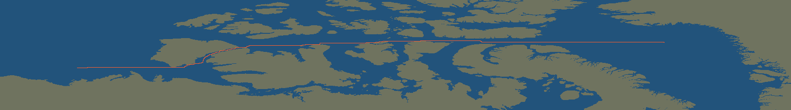
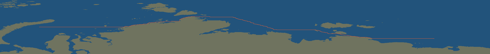
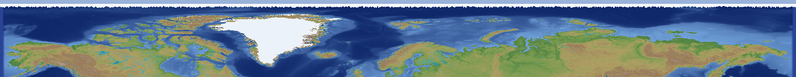
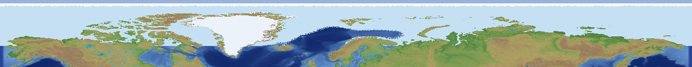
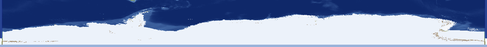
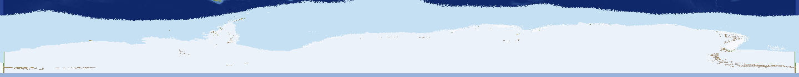

# Seasonal sea ice — Cylinder World 0.11.0

Earth-mode worlds now use separate **seasonal sea ice** and **permanent sea ice** blocks. Seasonal ice freezes
exposed ocean saltwater and thaws back to saltwater. The permanent Wall approach, its ridges and snowdrifts,
Antarctica's continent and ice shelves, and Greenland's land ice keep their existing terrain. The final kilometre
at both Walls remains lifeless; the Antarctic wildlife, hot-spring and trader guards remain active.

This feature defaults on for new and existing Earth-mode saves. It does not change Cylinder World's default
polar layout. Earth Map's source and package are not edited.

## Seasons and existing saves

The normal calendar drives opposite seasons: maximum northern sea ice around March and minimum around
September, reversed in the south. A fixed-season override instead applies the selected local season in both
hemispheres, matching vanilla and Earth Map climate. Coverage uses Earth Map's ocean mask, coldest/warmest-month
climate and an irregular freezing edge; it is a gameplay model, not an observed sea-ice dataset.

Antarctic sea ice really does change substantially: almost all of it grows and melts seasonally. The continental
ice sheet and ice shelves are different and stay permanent in this implementation.
[NSIDC explanation](https://nsidc.org/learn/parts-cryosphere/sea-ice/science-sea-ice).

The new blocks inherit vanilla lake ice's collision and breaking behaviour, but return **saltwater**. Vanilla's
random warm-air melting is disabled; the seasonal manager owns thawing. Permanent sea ice means year-round ice,
not the Wall's unbreakable material. It can still be broken or affected by vanilla hot-item interaction.

Only loaded chunks update. The main-thread worker visits small batches, capped at 256 columns inspected,
24 changed columns and roughly 3 ms per 100 ms tick; an individual block operation can exceed that time target.
No remote terrain is loaded for ice updates. Old 0.10.x ocean floes outside the permanent approach are converted
at their two sea-level layers, removing both layers when thawed. Snow directly over melting ice is cleared.
Solid construction and land are preserved, and freezing is deferred when an entity intersects the target block.
Refrozen ice is initially bare; weather can put snow on it later.

After a large date jump or loading an old area, allow time for the local ice to catch up. A large loaded view can
take minutes. `/cyl info` reports the target, not a promise that every visible block has already changed.
Setting `SeasonalSeaIce` to false stops this updater; it does not roll blocks back.

The minimap/world map can render the actual updated blocks as their tiles refresh. `/cyl map` previews the
current target coverage without loading chunks. Earth Map's own `/earth map` remains its separate, unmodified
terrain preview and does not include Cylinder World's seasonal ice.

## Canada and Siberia

Checked against Earth Map's terrain model at **256000 × 102400**, height 384, sea level 165, test seed 4242,
with the current projection and a 2240-block seam gutter. A grid search was followed by checking every block
across each candidate's **13-block-wide corridor**, requiring **at least 4 water blocks of depth**.

| Region | Terrain alone | Previous fixed ice | Summer minimum | Winter maximum |
|---|---|---|---|---|
| Canadian archipelago | Route verified | No route found | 532,649 corridor cells verified | No open route found |
| Northern Siberia | Route verified | No route found | 802,217 corridor cells verified | No open route found |

Thawing alone opens the checked routes; no canals or terrain edits were necessary. A failed coarse search is
not proof that every imaginable alternative is blocked. These are model results, not a scan of explored save
chunks or a completed ship voyage. Local generated structures, prior terrain versions and player construction
can differ. Magelan's Carrack has a declared 6-block-wide hitbox, but its complete hull/turning clearance still
needs an actual sailing trial. The corridors do not certify the full Atlantic/Pacific approaches or seam crossing.

The orange line is the checked summer route; blue is deep-enough ocean, grey is land/shallow water, pale blue
is ice. North is up. These are rectangular projections, so apparent east-west distances are stretched near the poles.

Canada, summer:

Siberia, summer:

Full sampled routes: [Canada CSV](sea-ice-routes/canada-summer-route.csv),
[Siberia CSV](sea-ice-routes/siberia-summer-route.csv).

## Inspection commands

Use a development world in creative flight. The game's `/time setmonth` **advances the world calendar**.
For northern late-summer inspection, use `/time setmonth sep`, then `/time add 0.5 months` to get near the
minimum. For northern winter use `/time setmonth mar`, then `/time add 0.5 months`. Southern sea ice is
opposite: March is near its minimum, September near its maximum. Fixed-season worlds need their normal
season setting restored before changing dates will change the ice. Use `/cyl info` at ocean points to inspect
the target and wait for loaded ice to update.

These are inspection waypoints on/near the sampled route, **not straight-line sailing instructions between them**.

| Place | Command |
|---|---|
| Canada, western entrance | `/earth tp 71.007 -135.025` |
| Amundsen Gulf | `/earth tp 71.513 -119.997` |
| Western channel bend | `/earth tp 73.428 -114.992` |
| Central archipelago | `/earth tp 73.991 -99.978` |
| Lancaster Sound approach | `/earth tp 74.216 -90.025` |
| Baffin Bay, eastern end | `/earth tp 73.991 -65.002` |
| Kara Sea | `/earth tp 75.020 65.008` |
| North of Taymyr | `/earth tp 77.779 104.989` |
| Laptev Sea | `/earth tp 74.401 125.008` |
| East Siberian Sea | `/earth tp 73.275 140.022` |
| Eastern Siberian route end | `/earth tp 71.980 165.002` |
| Antarctic seasonal sea ice | `/earth tp -65 20` |
| Previously reported Antarctic coast | `/earth tp -70 20` |
| Antarctic peninsula | `/earth tp -70 -65` |
| Permanent northern approach | `/earth tp 89 20` |
| Walls | `/cyl gowall north` / `/cyl gowall south` |

## Seasonal coverage previews

Same test world. Arctic panels cover 90°N–55°N; Antarctic panels 55°S–90°S. Pale blue is seasonal ice,
white is permanent ice/glacier, and the blue stripe marks the lifeless Wall border. These show policy coverage,
not in-game screenshots or historical sea-ice observations.

Arctic summer:

Arctic winter:

Antarctic summer:

Antarctic winter:

