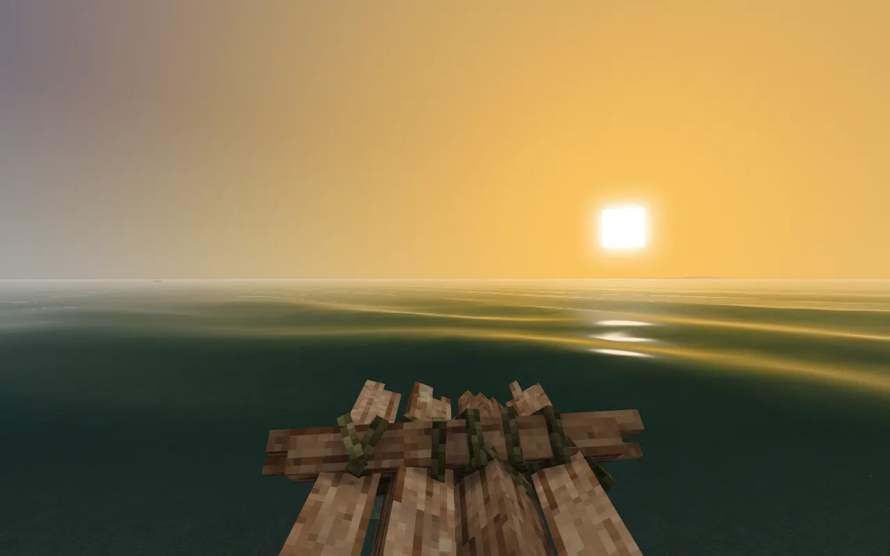

# Cylinder World

Cylinder World makes a Vintage Story world into a planet strip. The world wraps east–west: sail or walk far enough
east and you arrive back from the west, with no visible edge. The north and south ends are the poles, walled off by
ice. Latitude runs from the north wall to the south wall, and the climate, the sun, day length and the seasons follow
it, with the southern hemisphere's seasons reversed.

This wiki describes **Cylinder World 1.1.2** for Vintage Story 1.22.

## What it needs and what it works with

- **Vintage Story 1.22.0 or later.** Install it on the server and on every client (it is needed on both sides).
- **No other mods are needed.** It works in ordinary worlds made with the standard world type.
- **Earth** (the real-Earth map) requires Cylinder World and builds the real Earth on its strip. **Sea** and **World
  Map** know about the wrap. See [Compatibility](Compatibility).

## Install

1. Put `cylinderworld-1.1.2.zip` into your `Mods` folder (on a server, the server's `Mods` folder; players get it
   from the server or install the same zip).
2. Create a **new world**. If you add the mod to an existing world it still switches on: the world wraps and new chunks get the seam sea,
   walls and planet climate, but chunks already generated near the edges keep their terrain and the spawn stays where
   it is. To leave an existing world alone, set `Enabled` to `false`.

## Quick start

1. On the world-creation screen, open **Customize**, then the **World generation** tab, and choose a world size. The
   world must be wider (east–west) than it is long (north–south) for a planet's proportions; for example 256,000 ×
   102,400 blocks gives a ring of 204,800 blocks and 102,400 blocks from pole to pole, like the real Earth. Smaller
   worlds work too (see [How it works](How-it-works)).
2. Create the world. You start at the latitude whose climate matches the **Starting climate** you chose (temperate is
   about 44°N).
3. Type `/cyl info` to see your latitude, where you are on the ring and how far the seam is.

## Pages

- [How it works](How-it-works): the strip, the seam and the jump, the polar walls and ice, latitude, climate and
  seasons.
- [Settings](Settings): the hidden **Seam mist** option and every setting in `cylinderworld.json`.
- [Commands](Commands): `/cyl` and its test helpers.
- [Compatibility](Compatibility): Earth, Sea, World Map, other terrain mods, and saves.
- [FAQ](FAQ): common questions.

## Versions and problems

1.1.2 is the current release. Report problems on the mod's Mod DB page or in this repository's issues, if they are
enabled. The game's server log (`Logs/server-main.log`) has lines marked `[cylinderworld]` that help.
