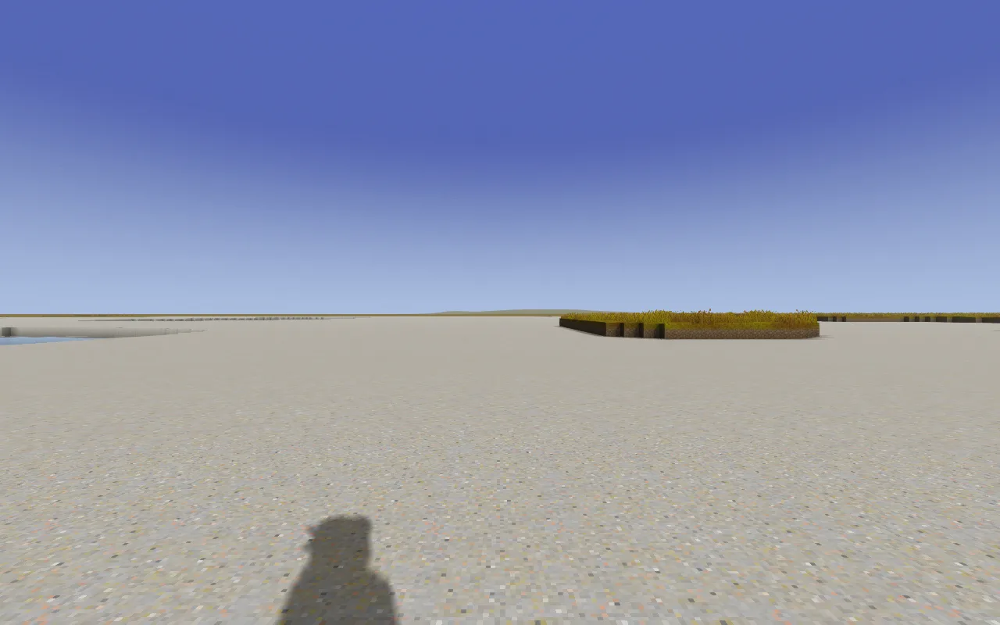
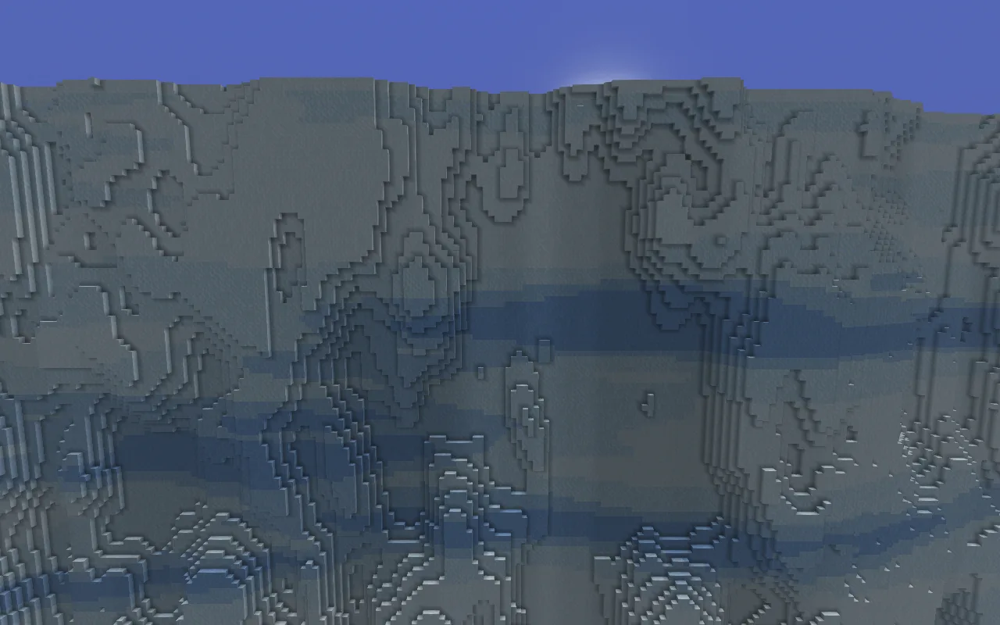
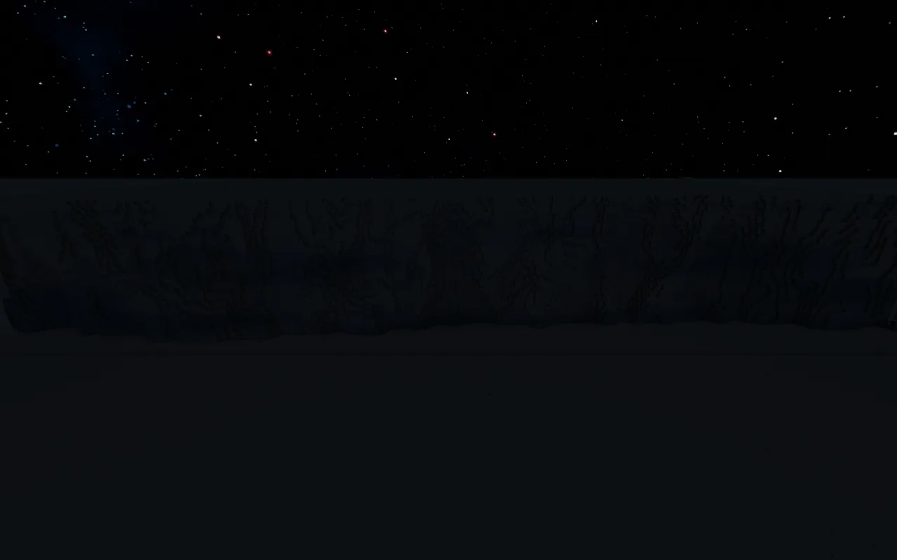

# How it works

## The planet strip

A Cylinder World world is a strip of a planet:
- **East–west** it wraps around: the world is a ring. Keep going east and you come back from the west.
- **North–south** it runs from the north pole to the south pole. The equator is the middle of the map, and the poles
  are the north and south ends, closed off by ice walls.

```
      north wall (90°N)
   ┌──────────────────────────────────────┐
   │ ice · tundra · cold · temperate · warm │
   │ ═══════════ equator (0°) ═══════════ │  ← east and west edges join through the seam
   │ warm · temperate · cold · tundra · ice │
   └──────────────────────────────────────┘
      south wall (90°S)
```

**Earth proportions** (config `EarthProportions`, on by default): if the world is more than twice as wide as it is long
(by at least 1,024 blocks at the default view distance), the ring is made exactly twice the world's length, as on the
real Earth. A world exactly twice as wide as long keeps a ring 1,024 blocks shorter. The unused strips at the far east
and west ends are never generated and cost nothing.

| World size (W × L) | Ring | Spawn to equator | Spawn to the north wall |
| --- | --- | --- | --- |
| 51,200 × 25,600 | 50,176 | 6,200 | 6,600 |
| 102,400 × 51,200 | 101,400 | 12,400 | 13,100 |
| 256,000 × 102,400 (Earth's proportions) | 204,800 | 24,800 | 26,300 |

## The seam and the jump

The east and west ends of the ring meet at the **seam**. Around it is a band of open ocean, about 3 km of sea to
cross with the default view distance. In the middle of that sea is the **jump line**. Anything that crosses it is
moved to the matching place on the other side of the world.



- Both sides of the jump are the same open sea down to the seabed, so there is nothing to see at the jump itself.
- **What crosses:** players, the animal or boat they ride, and (config `WrapOtherEntities`, on by default) drifting
  boats, dropped items and animals.
- **Before you arrive:** as you approach, the server loads the far side and sends it to your game ahead of time, so you
  arrive in a world that is already there. Your game keeps both sides while you are near the line, so turning back
  doesn't reload anything.
- **If the far side isn't ready** (a very fast crossing, a slow server), the jump is put off: you travel on past the
  line, over the same sea, until the far side is loaded, then cross with the usual safe-landing check.
- **After a jump** you can't jump again for 3 seconds (`JumpCooldown`). If you turn straight back, you sail on just
  past the line until then.
- **Building in the band:** the seam band is protected; nobody can build or break blocks there except in creative mode
  (`ProtectSeamBand`). Blocks changed near the line (for example by an admin) are changed on both sides, chests and
  other containers included.
- **Weather:** the rain, clouds and weather regions on both sides of the seam are kept the same, so the sky doesn't
  change at the jump.
- **Seam mist:** worlds can show a sea mist around the jump line and a short fog after a jump. It is **off** in new
  worlds; an admin can switch it on (see [Settings](Settings)). Without the mist your game is sent the whole view
  around the arrival point before the jump instead.

Known limits:
- Lightning isn't mirrored across the seam, and rain particles already in the air stay where they are.
- On a boat, the jump can pull you back a little: the server moves the boat, and your game was a moment ahead of it.
- Each side keeps its own snow, so the two sides can differ by a layer of snow at the line.
- Coordinates on the HUD and the world map are the raw X position, not a longitude.

## The polar walls and the ice

At each end of the world is **the Wall**: a cliff of layered ice about 48 blocks above the ice in front of it.



- The Wall can't be mined, blown up or built on, and nobody can place or break blocks within 32 blocks of its face
  (creative mode is exempt).
  Survival players who get on top of it or behind it are put back in front.

**In ordinary worlds** (not Earth): from 85° latitude to the Wall lies an **ice sheet**, a nearly flat plateau about
70 blocks above sea level that drops steeply only near its edge. Its edge is ragged, with tongues and icebergs; in
places it is an ice cliff, elsewhere a low ramp to the sea. Hills under it are buried, and nothing spawns on it. Beyond the edge, sea ice floes
thin out over a few hundred blocks; polar bears and arctic foxes can spawn on them. From 76° to the ice sheet lies
tundra, where trees fade out.

**In Earth worlds** the real polar lands are used instead: Antarctica's ice and mountains, Greenland, and the Arctic
Ocean. The Arctic and the Southern Ocean get **seasonal sea ice**: the sea freezes over in winter and thaws again in
summer (northern ice is least around September and most around March; the south is the other way round). Near the walls
the ice stays all year; in the north it has pressure ridges and snowdrifts. The last 1,000 blocks before either wall are lifeless (no
animals spawn there), and Antarctica has no polar bears or arctic foxes. The Wall is raised where needed to stand above
Antarctica's ice.



### The winter rule on the ice sheet

The ice sheet is deadly in winter. Below −40 °C a **cold exposure meter** fills, faster the colder it is and the
nearer the Wall. At the Wall in deep winter it fills in about 4 minutes, and a nearby fire only halves the rate. When it
is full, frost damage kills you. The game's frost effects follow the meter, and chat messages warn you as it rises.
In a world 102,400 blocks long (the ice sheet about 2,800 blocks wide), on foot in winter you freeze before reaching
the Wall; a fast mount can make it. In smaller worlds the sheet is narrower and easier to cross. In summer the ice is survivable for
days with good gear. `/cyl info` shows the live temperature and your exposure.

In Earth worlds the same rule runs on Antarctica's ice south of 60°S and on frozen Arctic sea in the far north.

## Latitude, climate and seasons

**Vanilla** repeats bands of climate north and south, set by the world's "Polar-Equator distance". **Cylinder World**
replaces that with one planet: +90° at the north wall, the equator at the centre, −90° at the south wall.

- **Temperature** falls from the equator to the poles the way Earth's yearly averages do: about 30 °C at the equator,
  20 °C at 30°, 9 °C at 45°, −5 °C at 60° and −30 °C at the walls (config `EquatorTemperature`, `PoleTemperature`).
  The game's seasons and altitude come on top.
- **Colder than vanilla allows:** vanilla's climate map stops at −20 °C. Cylinder World lets live temperatures go lower
  in its polar regions (the ice sheet at the Wall averages −40 °C, about −73 °C in winter).
- **Sun and seasons** follow your latitude: days lengthen and shorten with the seasons, there is midnight sun and
  polar night near the walls, and the southern hemisphere has its seasons reversed.
- **Spawn** is moved to the latitude whose temperature matches the world's **Starting climate** (temperate: about
  44°N), on the north half unless the config says `south`. **Story locations** move with it, and if the story chain
  wouldn't fit between the walls, its distances are scaled down.

In Earth worlds the temperatures and seasons are Earth's real climate instead; latitude, the sun and day length are
still Cylinder World's.

## Saved with the world

When a world first starts with Cylinder World, its layout (ring size, seam, walls, climate curve, spawn) is saved into
the world. Changing the config later only changes new worlds, except the settings listed as "read at every start" on
the [Settings](Settings) page.
